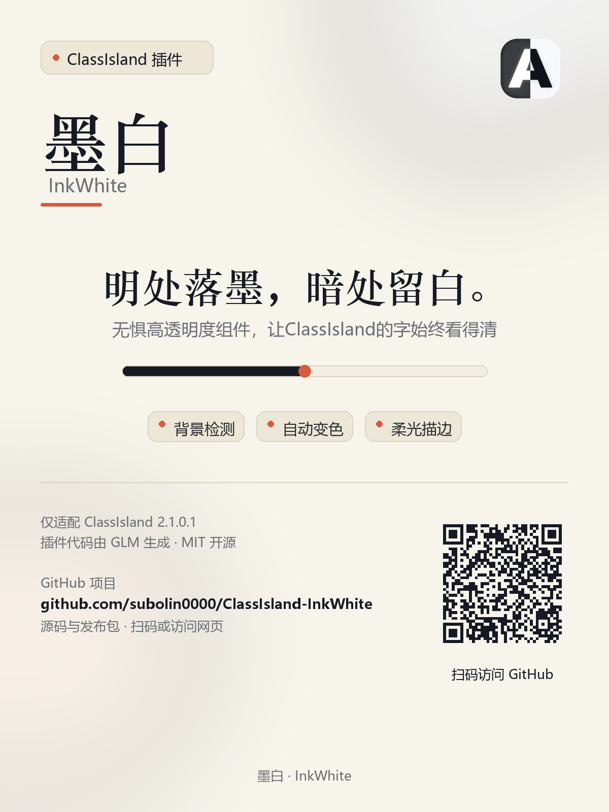

# 墨白 · InkWhite

> 仅适配 ClassIsland 2.1.0.1。插件代码由 GLM 生成，其他版本需另行适配。

## 一句话

**明处落墨，暗处留白。**

墨白是 ClassIsland 的配色插件。背景稳定后，通知遮罩、通知正文、文字、富文本、天气图标和分割线会统一切换为黑色或白色，使高透明度界面中的信息保持清晰。

## 适用范围

- 通知遮罩与通知正文
- 文字与富文本
- 天气图标
- 分割线

## 工作方式

- 背景稳定后再调整颜色，避免频繁变化。
- 默认等待 **3 秒**、渐变 **2 秒**；等待时间设为 **0 秒**时立即响应。
- 结合元素复杂度判断，复杂背景优先参考主导元素，减少背景文字干扰。
- 深浅主题切换后，先恢复原主题颜色，再重新检测。
- 不额外截屏，采用低开销统计，适合教室电脑长期运行。
- 柔光遇到玻璃材质或轮播容器时自动避让，保留主题材质，避免边缘发光不一致。

## 设置

- **颜色预设**：黑白均衡、黑色为主、白色为主。
- **描边 / 柔光**：独立开关，默认开启。
- **变色节奏**：等待时间与渐变时长均可调整。

## 安装

1. 到本仓库的 **Releases** 页面下载 `.cipx` 文件。
2. 打开 ClassIsland，进入 **设置 → 插件 → 从本地安装**。
3. 选择下载好的 `.cipx`，安装后重启 ClassIsland。

## 注意事项

- 仅适配 **ClassIsland 2.1.0.1 / Windows 10 2004+ 或 Windows 11**。
- 启用期间，ClassIsland 主窗口可能不会出现在部分截图、录屏或屏幕共享中。停用插件后恢复。
- 自定义位图图标、自绘文字暂不支持。

## 构建

安装 .NET 8 SDK 后，在仓库目录运行：

```powershell
./build.ps1
```

输出 `InkWhite-0.1.9.0-ci2.1.0.1.cipx`。原插件 ID 与程序集名保持不变，旧版可直接更新。

## 源码与许可

- **源码**：本仓库中的全部源文件。上传 GitHub 时随提交一并推送。
- **发布包**：`.cipx` 是编译后的插件包，用于安装；源码仍在仓库中。
- **许可证**：MIT License。可自由使用、修改和分发，请保留版权声明与许可文本。
- 许可文件：[LICENSE](LICENSE)

## 作者

**苏泊林 / subolin**

QQ：1570130637  
邮箱：[subolinChina@outlook.com](mailto:subolinChina@outlook.com)

GitHub：[github.com/subolin0000/ClassIsland-InkWhite](https://github.com/subolin0000/ClassIsland-InkWhite)
